<div align="center">

# 市场销售工作台 · Workstation Salesman

**「AI 个人工作台」系列 · 市场销售篇**

双击就能打开的销售作战室：线索商机、跟进日历、报价单、签约客户回访与续费、<br>
市场活动 ROI、业绩分析，外加支持 OpenAI 兼容接口和 Anthropic Messages 接口的 AI 销售助理。<br>
**一个 HTML 文件，核心功能不用安装、不用注册，业务数据保存在本机浏览器。**

[下载完整代码包](https://github.com/cyberdaddyleo/workstation-salesman/archive/refs/heads/main.zip) · [详细使用指南](docs/USER_GUIDE.md) · [使用许可](LICENSE)

> 当前版本：v1.0.0，适用于单人、电脑端使用。AI 为可选功能；调用外部 AI 时，所选资料与输入内容会发送到你配置的服务商。


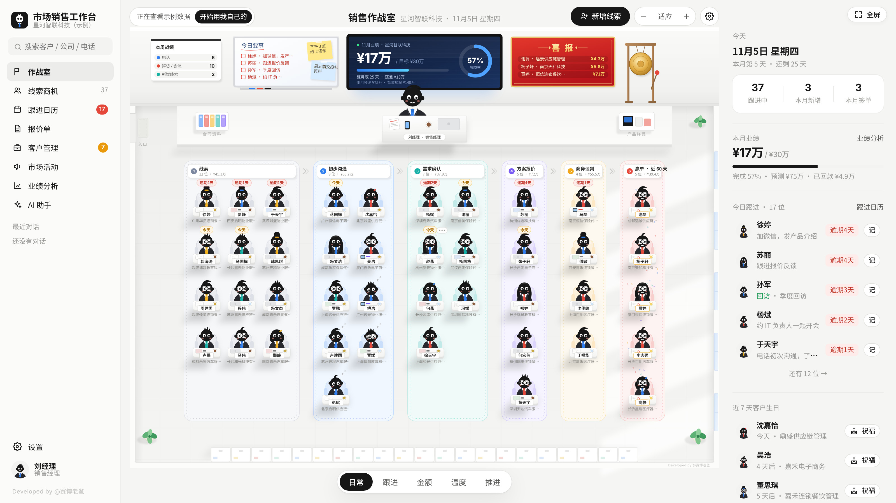

</div>

---

## 目录

- [适合谁用](#适合谁用)
- [功能一览](#功能一览)
- [快速开始](#快速开始)
- [接入 AI](#接入-ai)
- [数据与隐私](#数据与隐私)
- [文件说明](#文件说明)
- [常见问题](#常见问题)
- [日常使用流程](#日常使用流程)
- [使用许可](#使用许可)
- [商用版与合作](#商用版与合作)

---

## 适合谁用

- 一线销售、客户经理、渠道经理：客户一多就记不住谁该跟、谁快签、谁要续费
- 市场人员：想算清楚每场活动、每笔推广费到底带来了多少线索和成交
- 个体老板、自由职业者、小团队负责人：不想为了管客户去买一套复杂的 CRM

打开就是一间「销售作战室」：每位客户是一个系着领带的小人，站在他所处的销售阶段里，谁该联系、谁卡住了、谁刚签单，一眼就能看到。

---

## 功能一览

### 1. 销售作战室

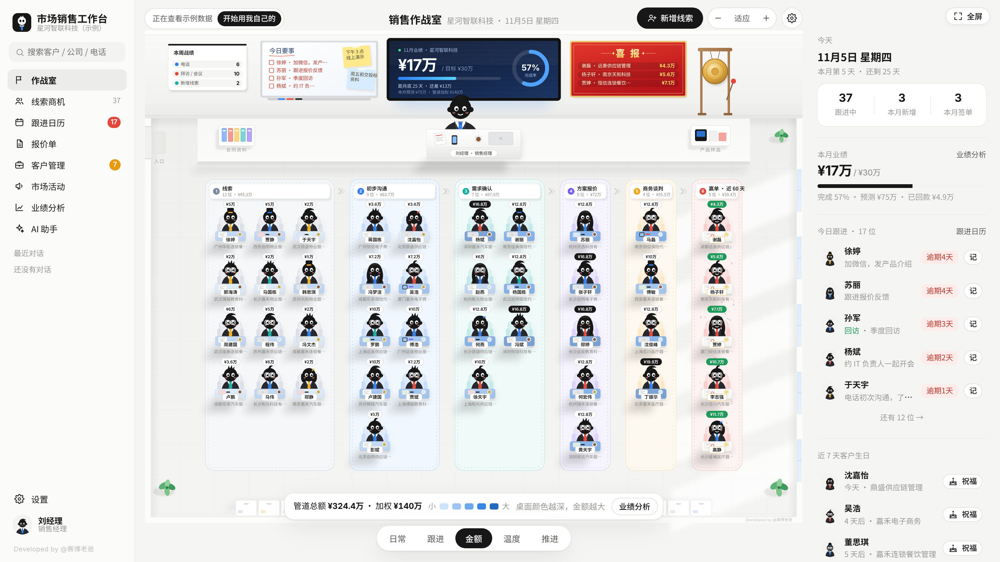

- 客户按阶段站在 **线索 → 初步沟通 → 需求确认 → 方案报价 → 商务谈判 → 赢单** 六个区域，**领带颜色代表客户等级**（A 红、B 蓝、C 青）
- 五种视图一键切换：
  - **日常**：看今天要联系、逾期没联系、沉睡的客户
  - **跟进**：看每个人的下次跟进时间
  - **金额**：按金额大小给客户着色
  - **温度**：按多久没联系分热、温、凉、冷
  - **推进**：把小人拖到下一个区域，就推进了阶段
- 前墙大屏实时显示本月业绩、目标完成度、月底预测和管道加权金额；白板写着今日要事；喜报栏滚动最近成交
- 签单时会敲锣、撒花、上喜报（可在设置里关掉动画和声音）
- 场景支持滚轮缩放、拖动平移，右侧栏是今日跟进、本月业绩和客户生日提醒

### 2. 线索商机

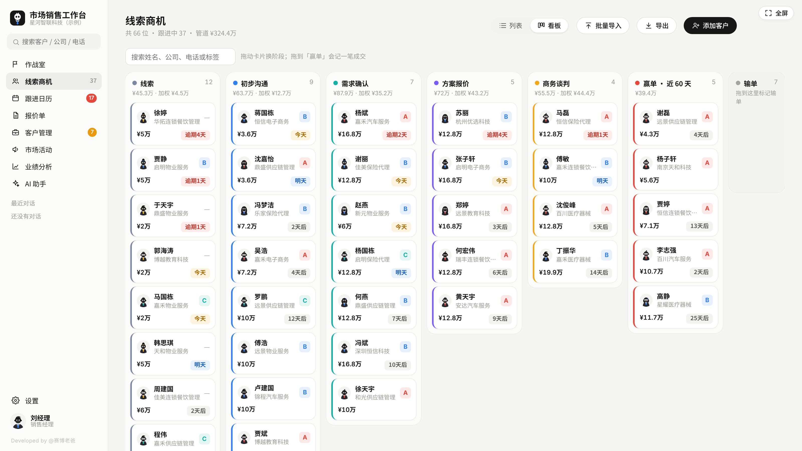

- **列表 / 看板** 两种视图；看板里拖动卡片就能换阶段，拖到「赢单」会自动记一笔成交
- 「新增线索」可以直接添加任意阶段的客户，包括已经成交的老客户
- **记一笔跟进**：电话、微信、拜访、会议、演示、邮件，顺手推进阶段、约好下一次
- 客户档案：基本信息、决策角色、需求痛点、预算、竞争对手、来源渠道、全部跟进记录、成交与报价
- 赢率可按阶段默认，也可单独调整；自动计算加权金额
- **批量导入**：Excel 里复制粘贴，或选 CSV 文件，支持下载导入模板；随时导出 CSV

### 3. 跟进日历

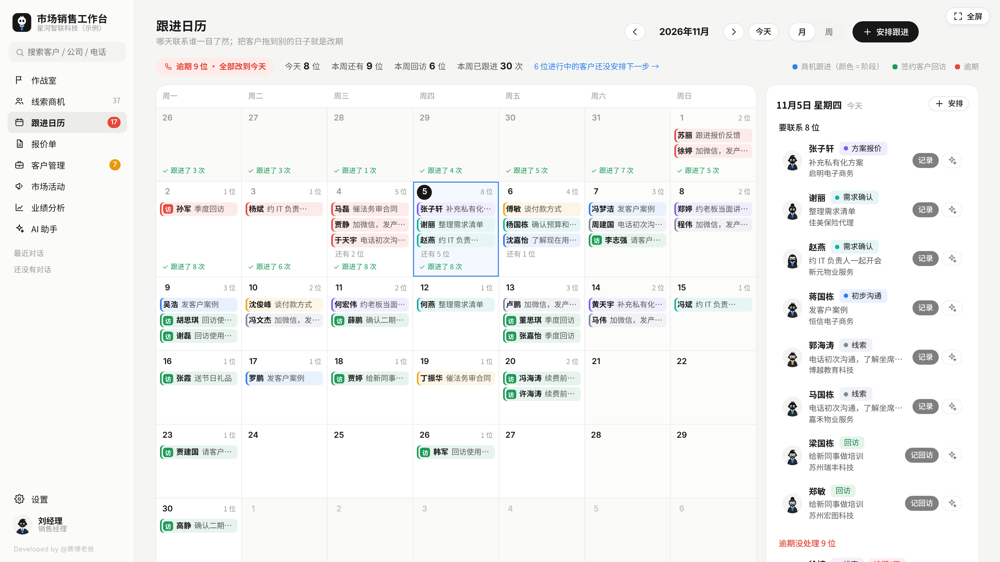

- **月视图 / 周视图**：哪天联系谁一目了然。商机跟进按阶段着色，签约客户回访是绿色的「访」，逾期的标红
- **把客户拖到另一天就是改期**
- 点某一天，右侧列出当天要联系的人和已做的跟进记录，可以直接记录，或者让 AI 写好消息
- 逾期一键「全部改到今天」，还会提醒哪些进行中的客户还没安排下一步
- 沉睡客户（太久没联系）单独列出，可以批量写唤醒消息

### 4. 报价单

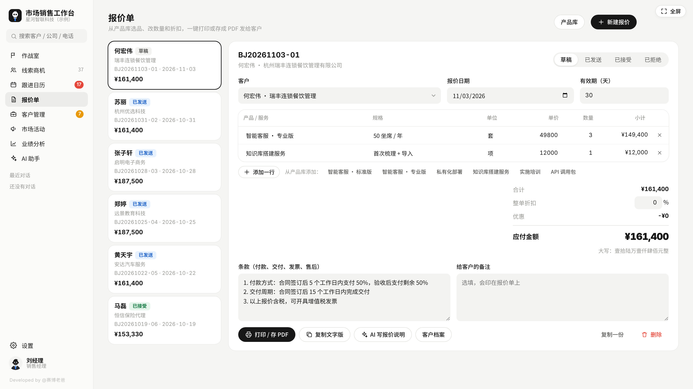

- 从产品库选产品，改数量、单价、折扣，自动算合计，并写好**中文大写金额**
- 报价条款、有效期、备注都能改；状态分为草稿、已发送、已接受、已拒绝
- 一键打印，或另存为 PDF 发给客户

### 5. 客户管理（签约客户回访）

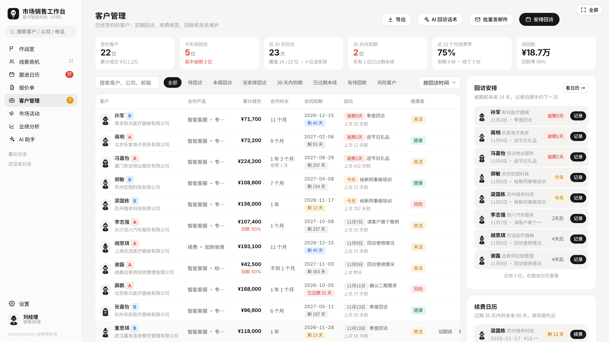

- 专门管理已经签约的客户：**回访安排、合同到期、续费续签、回款、健康度**
- 签单后会自动安排一周后的「成交回访」，之后可以按一周、一个月、三个月往后约
- 可按待回访、本周回访、没安排回访、30 天内到期、已过期未续、有待回款、风险客户筛选
- **续费日历** 和 **未来 6 个月到期金额**，提前准备续费；续费、续签、增购一笔笔记清楚
- 健康度会综合合同到期、回款、回访逾期和联系频率，自动标出健康、关注、风险
- **批量发邮件**：节日问候、复购优惠、续费提醒、使用须知、新功能通知、满意度回访
  - 支持 `{称呼}` `{公司}` `{产品}` `{到期日}` 等变量，逐个打开邮件或邮件合并时可按客户替换；密送使用统一正文
  - AI 可以帮你写主题和正文
  - 三种发送方式：逐个打开邮件、按 20 人一组密送、导出邮件合并 CSV；邮件需要由你自己的邮箱客户端或邮件合并工具实际发送，工作台不代发邮件

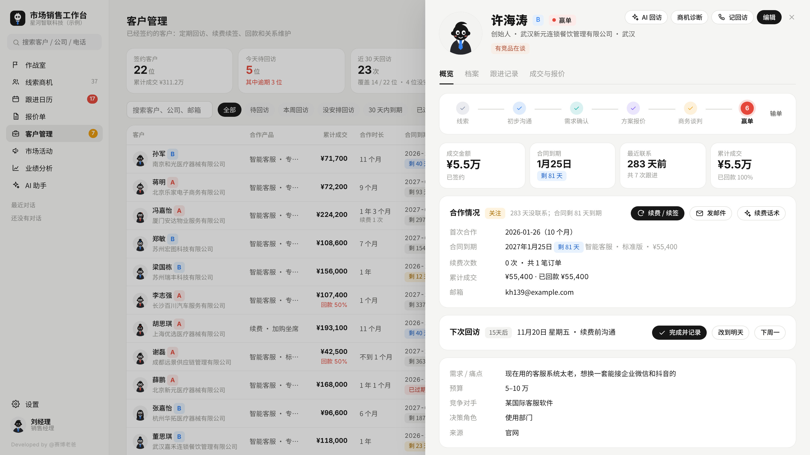

### 6. 市场活动

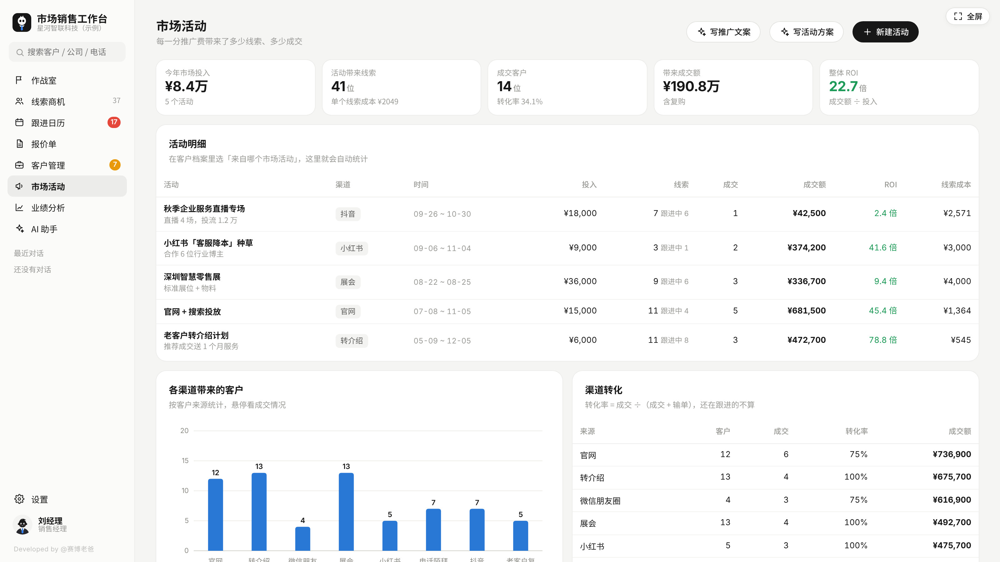

- 记录展会、直播、投放、沙龙等每个活动的投入
- 线索可以归到对应活动，自动算出**线索数、单个线索成本、转化率、带来的成交额和 ROI**
- 本版本页面的 ROI 按「关联成交额 ÷ 活动投入」显示倍数，不是扣除成本后的利润回报率；请结合具体活动和日期口径解读
- 按渠道看各来源带来了多少客户、转化得怎么样
- AI 可以写推广文案和活动方案

### 7. 业绩分析

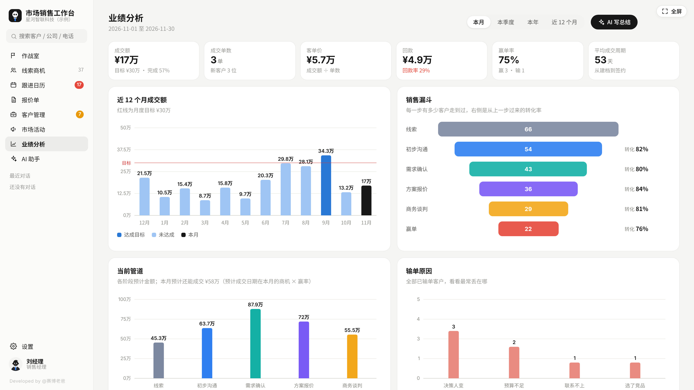

- 本月、本季度、本年、近 12 个月：成交额、目标完成度、客单价、回款率
- 近 12 个月成交趋势、销售漏斗、当前管道、输单原因、成交客户排行、待回款、平均成交周期
- AI 读取你的数据，直接写成周报或月报

### 8. AI 销售助理

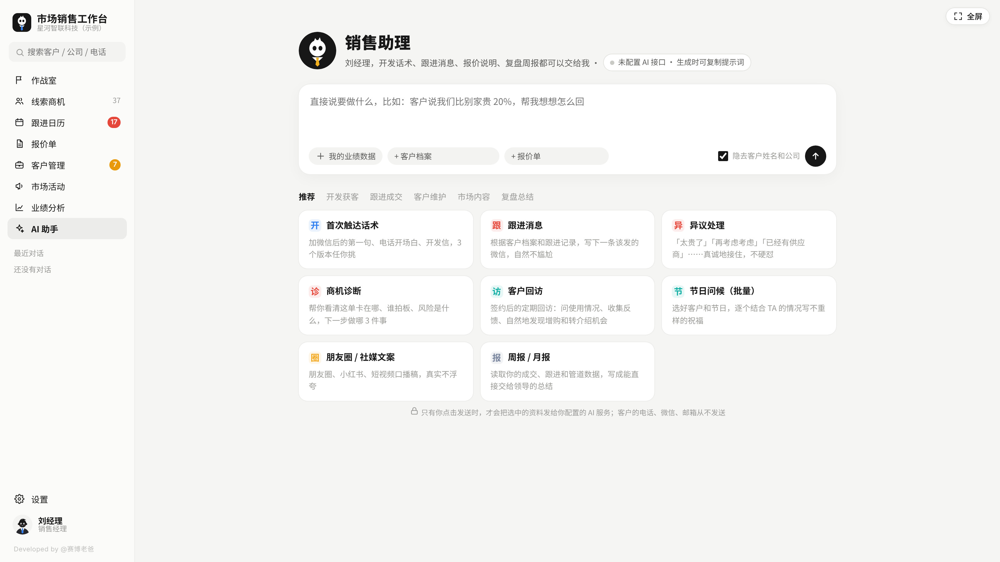

- 17 个销售场景模板，分为开发获客、跟进成交、客户维护、市场内容、复盘总结五类：
  首次触达话术、电话脚本、跟进消息、异议处理、商机诊断、拜访准备、会议纪要转跟进邮件、报价说明、成交感谢与转介绍、客户回访、续费沟通、节日问候（批量）、沉睡客户唤醒（批量）、朋友圈与社媒文案、市场活动方案、竞品对比话术、周报月报
- 也可以像聊天一样直接提问，并把业绩数据、客户档案、报价单作为参考资料附上
- 批量模式：选好一批客户，逐个结合每个人的情况写出不一样的消息
- **没有 API 也能用**：生成时可以复制完整提示词，粘贴到任何一个 AI 聊天工具里

---

## 快速开始

1. 下载本仓库（右上角 `Code → Download ZIP`），解压
2. 双击 `index.html`，用浏览器打开（推荐 Chrome 或 Edge）
3. 选一个你的形象，填上称呼，然后选：
   - **先看看示例数据**：内置数十位虚构客户、近一年的成交和报价，可以随便点、随便改
   - **从零开始**：填公司、月度业绩目标和主营产品，直接开始用
4. 看完示例，点作战室顶部的「开始用我自己的」就能清空示例数据（形象和 AI 设置会保留）
5. 建议先去 **设置** 里改好：
   - **业绩目标**：月度目标金额（当前版本使用统一月度目标）
   - **销售流程**：各阶段默认赢率、客户来源、输单原因、默认服务期
   - **产品库**：报价时直接选用的产品和价格

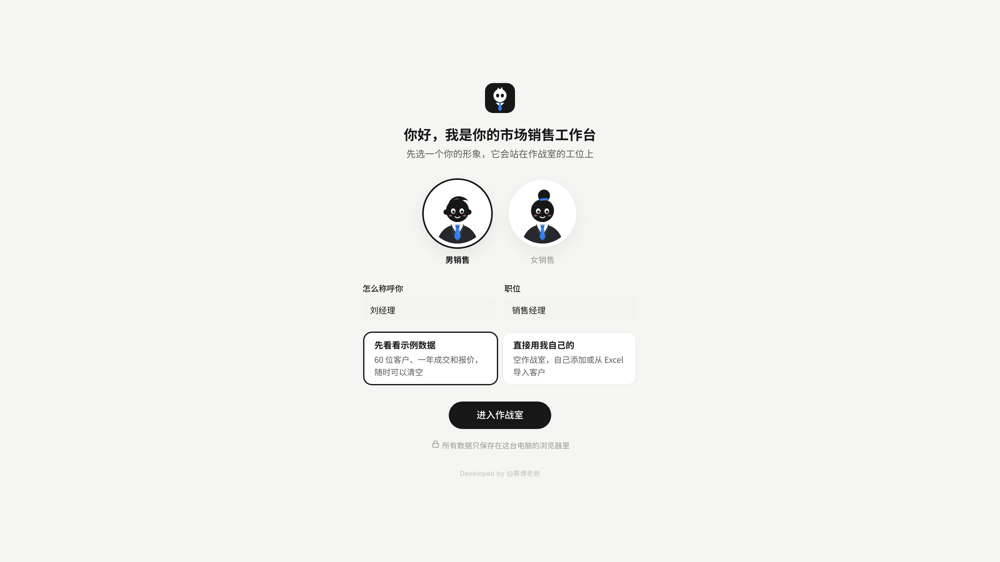

> 建议在电脑上使用，屏幕宽度 1440px 以上效果最好。开源版不支持手机端。

更详细的操作步骤、备份恢复和故障排查，请阅读 [使用指南](docs/USER_GUIDE.md)。本项目无需 `npm install`、构建工具、数据库或后端服务器；只有可选 AI 代理需要 Node.js。

## 日常使用流程

1. **收集线索**：在「线索商机」新增客户，记录公司、来源、预计金额和下一次跟进；已有表格可用 CSV 或复制粘贴导入。
2. **按计划跟进**：每天打开作战室或跟进日历，先处理到期与逾期任务，完成后「记一笔跟进」并安排下一步。
3. **推进并报价**：根据实际进展更新销售阶段，从产品库制作报价单，打印或另存为 PDF 发给客户。
4. **成交后维护**：登记赢单，在「客户管理」持续安排回访、记录回款，关注合同到期、续费与客户健康度。
5. **复盘与备份**：在市场活动和业绩分析中查看转化与成交，每周导出 JSON 备份；AI 可以辅助准备消息和总结，使用前请核实内容。

---

## 接入 AI

在 **设置 → AI 接口** 里选择服务商，填入你自己的 API Key 就能用。内置预设：

| 服务商 | 接口地址 |
| --- | --- |
| DeepSeek | `https://api.deepseek.com` |
| 通义千问（阿里云百炼） | `https://dashscope.aliyuncs.com/compatible-mode/v1` |
| Kimi（月之暗面） | `https://api.moonshot.cn/v1` |
| 智谱 GLM | `https://open.bigmodel.cn/api/paas/v4` |
| 豆包（火山方舟） | `https://ark.cn-beijing.volces.com/api/v3` |
| 硅基流动 | `https://api.siliconflow.cn/v1` |
| OpenAI | `https://api.openai.com/v1` |
| Claude（Anthropic） | `https://api.anthropic.com/v1` |
| Ollama 本地模型 | `http://localhost:11434/v1` |
| 自定义 | 任何兼容 OpenAI 格式的接口 |

API Key 保存在本机浏览器的 localStorage 中，未加密；调用 AI 时会随请求发送给你配置的服务商，使用本地代理时也会经过该代理。请只填写可信的接口地址，避免在共享电脑保存密钥。

表中地址是本版本内置预设。请按服务商控制台当前提供的接口地址、可用模型和权限填写「模型名称」；内置示例模型不保证对每个账号可用。第三方 AI 服务可能单独计费。

### 提示「连不上」怎么办

有些服务商不允许网页直接调用（浏览器的跨域限制）。可以先换一家服务商试试，或者用仓库里的 `ai-proxy.js` 在本机转发：

```bash
# 1. 电脑装好 Node.js（https://nodejs.org，装 LTS 版即可）
# 2. 在本文件夹打开终端，运行：
node ai-proxy.js
```

然后在 **设置 → AI 接口** 里，把接口地址改成 `http://127.0.0.1:8787/` 加原地址，例如：

```
http://127.0.0.1:8787/https://api.deepseek.com
```

`ai-proxy.js` 只监听 `127.0.0.1`，不主动保存请求正文或密钥，也不需要安装任何依赖；终端会显示请求时间、方法和目标地址路径。用的时候保持终端窗口开着，结束后按 `Ctrl+C` 停止。代理只解决部分跨域连接问题，不会修复无效密钥、错误模型或账户额度问题。

---

## 数据与隐私

- **业务数据默认保存在本机浏览器**（localStorage），核心功能不需要服务器或云账号。AI 调用、手动导出和邮件发送会按你的操作向相应目的地提供内容
- 清理浏览器数据、换电脑或更新文件位置之前，请先到 **设置 → 数据与备份** 导出备份（JSON 文件），在新环境中「从备份恢复」即可。不同浏览器、浏览器配置和页面来源的存储通常互不共享；本地 `file://` 文件的存储行为可能因浏览器和文件位置而不同
- JSON 备份包含完整业务数据与设置，包括已保存的 AI Key；请妥善保管，不要上传到公开仓库或随意分享。恢复前先备份当前数据，恢复会替换现有状态
- 使用 AI 时，生成、重试、批量处理、AI 写邮件和连接测试等操作会发起请求；正常生成可能携带个人与公司设置、主营产品、所选资料、输入内容及对话上下文，请在使用前检查
- 普通 AI 助手勾选「隐去客户姓名和公司」后，会尝试将已登记的客户姓名和公司替换为「客户07」「公司07」这样的代号，并在结果中还原；邮件 AI 草稿分支不应用这一替换，不能把它视为所有 AI 入口的统一隐私保证
- 内置客户资料摘要不主动附加电话、微信和邮箱字段，但手动输入、备注、跟进记录或历史对话仍可能包含这些信息；姓名和公司替换不是完整的敏感信息过滤
- 群发邮件通过你电脑上的邮件客户端或邮件合并工具发出；工作台不保存邮箱登录凭据，但会在本地保存邮件草稿、收件人关联和发送标记

---

## 文件说明

```
├── index.html      # 软件本体，双击打开即可使用
├── ai-proxy.js     # 可选：AI 本地转发，解决部分服务商的跨域限制
├── LICENSE         # 开源协议（个人非商业许可）
├── README.md       # 软件介绍、快速开始与功能概览
├── docs/
│   └── USER_GUIDE.md # 详细使用指南与故障排查
└── screenshots/    # 说明文档用的截图
```

整个软件就是一个 `index.html`，没有任何外部依赖，断网也能打开（AI 功能除外）。

---

## 常见问题

**数据会丢吗？**
数据保存在浏览器的 localStorage 中，但清除站点数据、重装系统、更换浏览器或存储异常都可能导致无法读取原数据。浏览器禁用持久化存储时，软件可能只能临时保存在内存，关闭页面后不能依赖它保留数据。请定期导出 JSON 备份；设置页会显示上次备份的时间。CSV 仅用于名单交换，不能替代完整备份。

**换个浏览器打开，数据怎么不见了？**
每个浏览器的存储是分开的。在原来的浏览器里导出备份，到新浏览器里恢复就行。

**能多人一起用、手机上用吗？**
开源版是单人、PC 端版本。团队协同和手机端会在商用版中提供。

**不是做软件的，能改成我们行业吗？**
可以。产品库、销售阶段赢率、客户来源、输单原因、服务期都能在设置里改，不用改代码。

**不配 AI 能用吗？**
能。除了 AI 助手，其他功能都不需要 AI。AI 模板在没有配置接口时，也可以复制提示词去别的 AI 工具里用。

**作战室动画太多，电脑有点卡？**
到 **设置 → 作战室** 关掉动画和声音即可。

---

## 使用许可

本项目公开源代码，采用原作者的 **个人非商业许可协议**，完整条款见 [LICENSE](LICENSE)。公开代码不代表允许任意商业使用：

- ✅ 个人免费使用，包括在自己的工作中使用
- ✅ 修改、二次开发
- ✅ 免费分享，但需保留作者署名「Developed by @赛博老爸」和协议，并注明出处
- ❌ 未经授权的任何商业使用：出售、付费分发、放进付费产品或课程、公司统一部署、改名换皮等

---

## 商用版与合作

需要以下内容，欢迎联系：

- 商用授权、团队版（多人协同、数据同步）
- 手机端与多端协同
- 按你的行业和流程定制、本地化部署

📮 **cyberdaddyleo@outlook.com**

---

## 关于「AI 个人工作台」系列

每一期为一种职业做一个开箱即用的 AI 工作台，都是单文件、本地存储、打开即用。市场销售工作台是其中一期。

更多作品和更新，全网搜索 **@赛博老爸**。

<div align="center">

Developed by @赛博老爸

</div>
