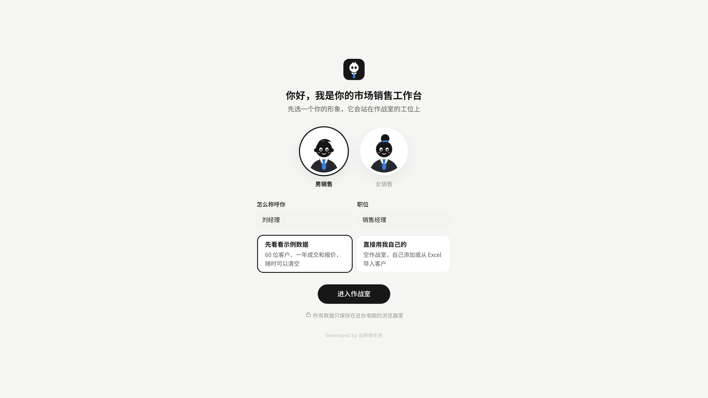
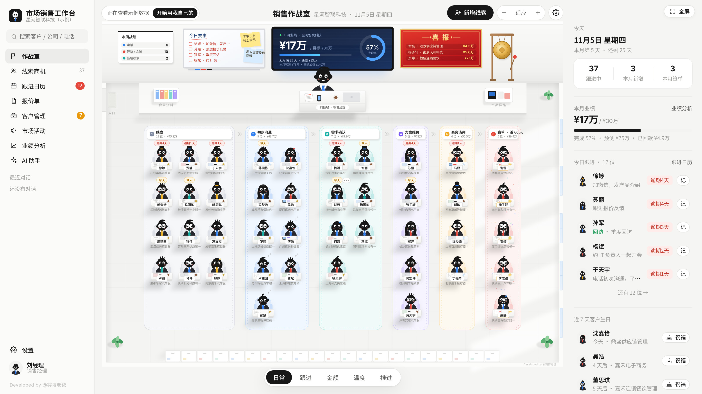
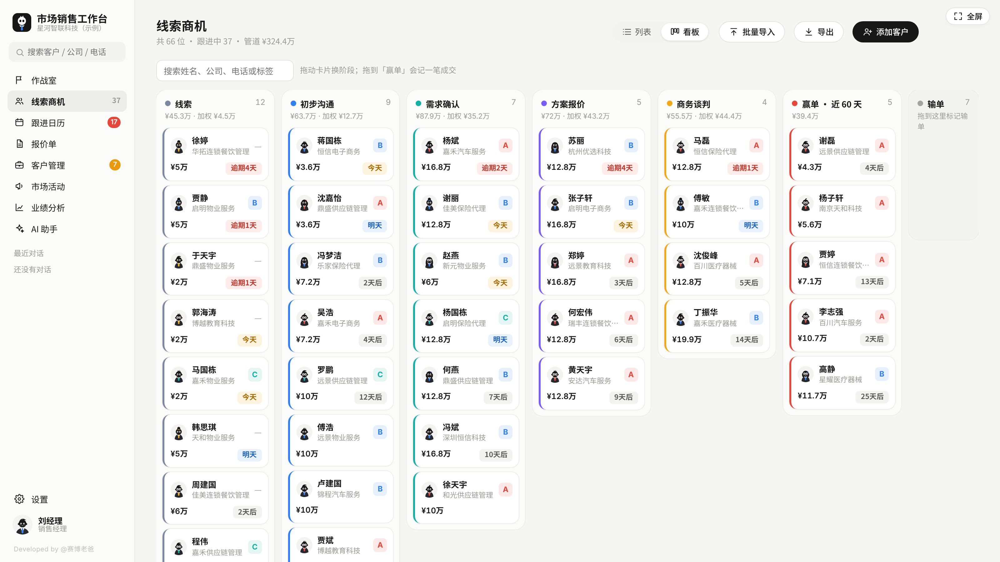
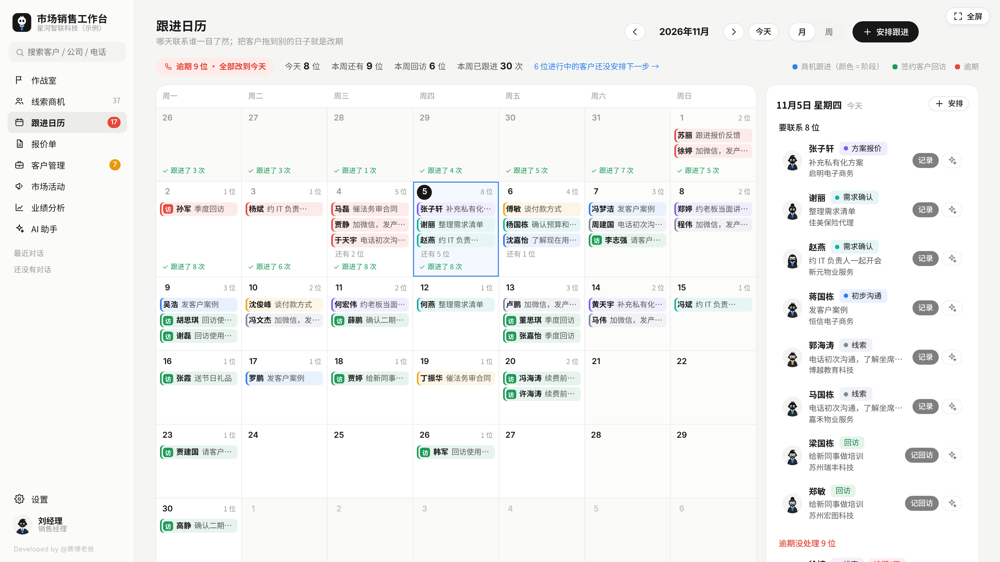
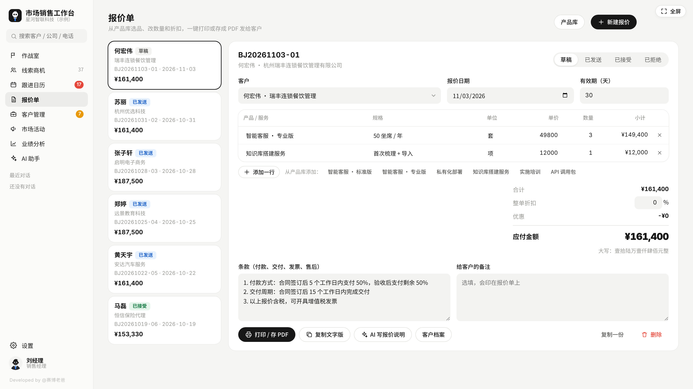
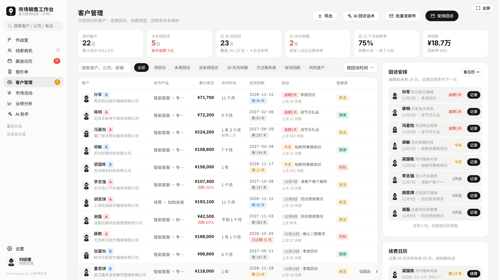
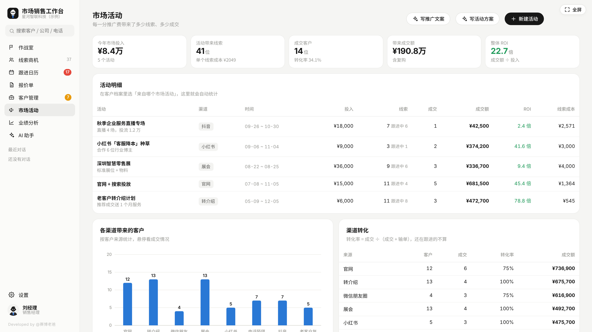
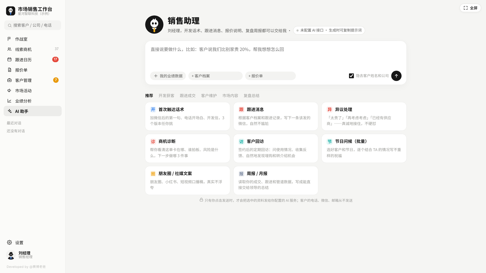

# 市场销售工作台使用指南

市场销售工作台把个人销售工作的线索、跟进、报价、成交、回访、市场活动和业绩放在一个页面里。软件本体是 `index.html`，用桌面浏览器打开即可使用；AI 接口和本地代理都是可选项。

本指南对应仓库当前版本的实际界面与行为。软件定位是个人、PC 端工作台，没有内置多人协作、账号登录或跨设备自动同步，也不承诺手机端体验。

[返回软件介绍](../README.md) · [查看个人非商业许可](../LICENSE)

## 1. 下载与打开

1. 在 GitHub 仓库主页点击 **Code → Download ZIP**。
2. 解压到一个固定文件夹，保留 `index.html`、`LICENSE` 和文档。需要 AI 本地转发时，再使用同目录的 `ai-proxy.js`。
3. 双击 `index.html`，或者右键选择用桌面浏览器打开。它是网页文件，不需要安装程序或注册账号。
4. 后续尽量继续用同一个浏览器、同一个浏览器用户配置和同一打开地址访问。

也可以单独下载真正的 `index.html` 文件运行；不要把 GitHub 展示源代码的页面另存为软件本体。解压后双击打开是最直接的开始方式。

软件主要管理功能可离线运行。调用远程 AI 时需要网络；打印、打开邮件等操作则依赖浏览器和电脑已配置的对应功能。较宽的电脑屏幕更适合查看作战室、表格与图表，1440 像素及以上宽度更从容。

### 数据并不写回 HTML 文件

客户和设置保存在浏览器的 **localStorage** 中，复制或发送 `index.html` 不会把自己的客户资料一起带走。换电脑或换浏览器，需要另外导出并恢复 JSON 备份。

localStorage 按浏览器、浏览器用户配置和页面来源隔离。通过网站访问时，协议、主机名、端口不同，通常就是不同来源，例如 `http://localhost:8000` 与 `http://127.0.0.1:8000` 的存储不同。直接双击产生的 `file://` 地址，其本地存储行为可能因浏览器和文件路径而不同；移动、改名或重新下载文件后，不应假定原数据一定可见。

在更换打开方式、文件位置或浏览器前，先导出 JSON 备份。不要把浏览器本地存储当作唯一副本。

## 2. 第一次进入：先体验，或从零开始

首次打开会显示欢迎页，先选择形象，填写“怎么称呼你”和职位，再选择一种开始方式。



| 入口 | 适合的情况 | 进入后会看到什么 |
| --- | --- | --- |
| **先看看示例数据** | 想先了解操作和页面 | 数十位示例客户、近一年成交和报价等演示内容 |
| **直接用我自己的** | 准备开始正式记录 | 空工作台，可填写公司／品牌、月度业绩目标、主营产品／服务 |

点击 **进入作战室** 完成初始化。

体验完示例后，点击作战室顶部的 **开始用我自己的**，填写公司、目标和主营产品，再点 **清空并开始**。此操作会替换当前示例工作区，保留个人形象资料和 AI 设置。若已经在示例里添加了真实客户，先导出备份，避免一起清空。

设置页的 **数据与备份 → 载入示例数据** 也会覆盖当前业务数据，不是向现有客户中追加示例。需要返回正式数据时，使用之前导出的 JSON 备份恢复。

## 3. 正式使用前，先检查这些设置

打开左侧 **设置**。设置页修改后自动保存，不需要寻找统一的“保存设置”按钮。

| 设置页 | 建议填写或检查 | 会影响什么 |
| --- | --- | --- |
| **我的形象** | 称呼、职位、公司／品牌、主营产品、行业、联系方式 | 页面身份信息、报价抬头、AI 参考资料 |
| **业绩目标** | 月度目标金额、多少天未联系算“沉睡” | 作战室目标完成度、业绩分析、沉睡客户提醒 |
| **销售流程** | 阶段默认赢率、默认服务期、客户来源、输单原因、报价默认条款 | 商机预测、续费提醒、来源统计、新建报价 |
| **产品库** | 名称、规格、单位、单价 | 新建报价时选品，也会进入部分 AI 参考资料 |
| **作战室** | 便利贴、墙上标语、动画与敲锣音效 | 作战室显示与声音 |
| **AI 接口** | 服务商、地址、模型、Key、脱敏选项 | 是否能在工作台直接生成 AI 内容 |
| **数据与备份** | 存储状态、上次备份时间 | 检查数据保存并导出备份 |

月度目标是一个统一数值，季度、年度目标按这个数值乘月份数计算；当前没有为每个历史月份分别配置目标的功能。销售流程设置可调整默认赢率，当前阶段名称和顺序仍是固定的。

报价默认条款含付款、交付、发票等示例内容，请改成自己真实适用的文字后再对外使用。一次性销售可把默认服务期设为 **一次性**；有服务期限的业务可选 6、12、24 或 36 个月。

## 4. 一天的工作可以这样安排

1. **开始工作时**：打开作战室或跟进日历，先看今天要联系、逾期和未安排下一步的客户。
2. **收到新线索时**：新增客户，填写来源、需求、预计金额，并安排下次跟进。
3. **每次沟通后**：记下实际内容，更新阶段，约好下一次动作。
4. **发方案时**：创建报价，核对产品、折扣、条款与有效期，打印或存成 PDF。
5. **成交后**：确认成交金额、日期、已回款及服务期，再检查回访安排。
6. **维护老客户时**：查看待回访、到期和待回款名单，记录续费或增购。
7. **收工或每周复盘时**：查看业绩与活动效果，导出一份 JSON 备份。

软件中的跟进安排是页面内的日历和提示，不等同于手机推送、系统闹钟或外部日历提醒。

## 5. 作战室：先确定今天做什么



客户按 **线索 → 初步沟通 → 需求确认 → 方案报价 → 商务谈判 → 赢单** 排列。领带颜色表示客户等级：A 类红色、B 类蓝色、C 类青色，未分级为黄色。

底部可切换 **日常、跟进、金额、温度、推进** 五种视图。日常视图适合找今天要联系的人；跟进视图查看计划；金额与温度视图分别查看金额大小和联系间隔；推进视图可拖动客户调整阶段。

可用滚轮缩放、拖动平移，或使用缩放和适配按钮。点击客户打开操作或档案，继续记跟进、编辑或推进阶段。阶段改为赢单时会打开成交表单，需填写并确认后才会记录成交。

大屏上的管道加权金额与预测由预计金额、赢率和预计成交日期计算，属于当前资料的估算，不是实际到账金额。实际成交和回款分别以成交记录及已回款字段为准。

## 6. 线索商机：录入、跟进与成交

### 新增客户

在作战室点 **新增线索**，或在 **线索商机** 页点 **添加客户**。

1. 选择客户当前阶段，并填写必需的联系人姓名。
2. 按掌握的信息填写公司、职位、决策角色、联系方式、行业、来源、等级和标签。
3. 填写预计金额、预计成交日期、需求、预算及竞争对手。赢率留空时使用阶段默认值，也可为该客户单独设置。
4. 安排下次跟进日期及要做的事，点击 **保存**。连续录入时可勾选 **保存后继续添加**。

已有成交的老客户可在新增表单中直接选 **赢单**，填写成交金额、成交日期和已回款。保存时会创建一笔成交，默认服务期取设置中的值，并安排后续回访。

客户来源用于渠道统计；**来自哪个市场活动** 用于具体活动归因。这两个字段用途不同，参加某个活动的客户建议都填好。

### 批量导入名单

在 **线索商机 → 批量导入** 中，可以：

- 从 Excel 复制含第一行表头的区域，粘贴到输入框；
- 点击 **选择 CSV 文件** 导入 UTF-8 文本；
- 先点 **下载模板**，按模板整理再导入。

必须有“姓名”列；还可识别公司、职位、电话、微信、邮箱、行业、城市、来源、等级、阶段、预计金额、预计成交、需求、备注等列。先核对识别出的客户数与列数，再点 **导入**。

导入会跳过“姓名和公司都与现有记录相同”的客户，不会更新这条现有记录。它不是完整数据恢复：跟进历史、报价、订单等不会随客户 CSV 一起还原。CSV 中即使写了“赢单”，当前导入逻辑也只设定客户阶段，不会自动生成成交订单；需要再到客户的 **成交与报价** 中补录。

### 使用列表与看板



**列表** 适合搜索、筛选和比较金额、日期；**看板** 适合按阶段查看并拖动推进。点击客户可打开四个档案页签：**概览、档案、跟进记录、成交与报价**。

### 记一笔跟进

在客户档案点击 **记跟进**，或在跟进日历点击 **记录**：

1. 选择电话、微信、拜访、会议、演示、邮件或其他方式。
2. 填写沟通内容和实际时间。
3. 如有进展，在 **顺便推进阶段** 中选择新阶段。
4. 选择下次跟进日期并说明要做什么；暂时没有下一步可选 **先不安排**。
5. 点击 **保存**。

每位客户当前只有一个“下次跟进／回访”安排。重新安排会替换旧的待办日期和事项，已经保存的沟通历史仍保留。

### 赢单、输单、复购与回款

推进到 **赢单** 后，在成交窗口填写金额、成交日期、产品／服务、已回款、服务期和备注，点击 **确认成交**。新成交会进入业绩统计，并安排一周后的成交回访；回访日期以操作时的当前日期为基础，补录历史成交后可按实际需要改期。

在客户档案的 **成交与报价 → 成交与回款** 表格中，直接修改 **已回款**。这里填的是该笔订单累计已收到的金额，不是本次新增回款金额；软件没有逐笔收款流水账。

已成交客户再次购买，可点击 **记一笔复购**。有期限的合同续费应使用 **续费 / 续签**，这样会记录新的服务期和续费类型。

标记 **输单** 时选择原因并补充说明，软件会清除该客户下次跟进安排，保留客户及历史记录，之后可在已输单筛选中找到。删除客户则会连同其跟进、成交和报价一起删除；需要保留历史时，优先使用合适的阶段状态。

## 7. 跟进日历：安排、改期、查漏



在 **跟进日历** 中切换月／周视图，点击某一天查看当天要联系的人和已经记录的沟通。商机按阶段着色，签约客户回访显示为绿色，逾期会提示。

- 点击 **安排**，选择客户、日期及事项；若该客户已有安排，保存会替换原安排。
- 将日历上的客户拖到另一天，可以直接改期。
- 今天的面板可直接 **记录** 或 **记回访**，也可用 AI 准备消息。
- 逾期列表中的 **全部改到今天** 会批量修改所有逾期计划日期，确认前先看清数量。
- 查看“还没安排下一步”的进行中客户，逐个补上动作；沉睡客户可从侧栏进入或使用 AI 批量唤醒模板。

“沉睡”根据多久没有跟进记录判断，因此真实沟通后及时记录，提醒才有参考价值。

## 8. 报价单：从选品到 PDF



1. 在 **设置 → 产品库** 录好常用产品，或在报价里直接输入产品信息。
2. 打开 **报价单 → 新建报价**，选择客户、报价日期和有效期。
3. 从产品库添加产品，调整规格、单位、单价和数量；需要更多项目时点 **添加一行**。
4. 输入整单折扣，检查优惠、应付金额及中文大写金额。
5. 修改付款、交付、发票、售后条款，以及给客户的备注。
6. 点击 **打印 / 存 PDF**，在浏览器打印窗口选择打印机或保存为 PDF；也可点 **复制文字版**。

**整单折扣填写的是减免百分比。** 例如原价 10,000 元，输入 `10` 表示优惠 10%，应付 9,000 元，即九折；不要为九折输入 `90`。

报价可标记为 **草稿、已发送、已接受、已拒绝**。点击状态只更新工作台记录：

- **已发送** 不会代你发送文件；关联客户处于较早阶段时，会推进到方案报价。
- **已接受** 后，对尚未赢单的关联客户会询问是否去记成交；仍需完成成交确认。
- **复制一份** 会生成新编号并设为草稿，适合调整另一套方案。

报价单显示的公司和个人联系方式来自设置。对外发送前，请检查客户、日期、金额、折扣和条款。

## 9. 客户管理：回访、续费和关系维护



**客户管理** 主要显示赢单或已有成交记录的客户。可按 **待回访、本周回访、没安排回访、30 天内到期、已过期未续、有待回款、风险客户** 筛选。

### 回访与续费

点击 **安排回访** 选择日期和事项；完成后点 **记回访**，记录使用情况、反馈或新需求，再选择一周、一个月、三个月后的下次回访，也可自行指定日期。

查看续费日历和未来六个月到期金额，提前安排联系。在客户合作情况或 **成交与报价** 中点 **续费 / 续签**，核对续费金额、签约日期、产品、已回款、新服务期起始日及期限，点击 **确认续费**。

健康度由合同到期、回款、回访逾期和联系间隔等规则计算，是排优先级的提示，需要结合真实客户情况判断。没有录入服务期的订单不会产生相应的合同到期提醒。

### 批量发邮件

在 **客户管理 → 批量发邮件** 中选择邮件类型和收件人，编辑主题、正文并查看预览。没有邮箱的客户不能被选中。可插入 `{称呼}`、`{公司}`、`{产品}`、`{到期日}` 等变量，或用 **AI 帮我写** 生成草稿。

| 方式 | 实际行为 |
| --- | --- |
| **逐个发送** | 为每位客户生成独立内容；点“打开邮件”调用电脑的邮件客户端，由你检查并发送 |
| **密送群发** | 每组最多 20 人，打开带密送地址的邮件；使用统一正文，不能做到每人一个到期日或称呼 |
| **导出邮件合并表** | 下载含邮箱、主题和个性化正文的 CSV，交给支持邮件合并的外部工具处理 |

工作台通过 `mailto:` 打开邮件，不直接连接邮箱账号，也不能确认送达。在当前版本中，逐个模式点击 **打开邮件** 就会记为已发送并新增邮件跟进记录；请以邮件客户端实际发送结果为准。密送中的 **都发出去了，记为已发送** 和其他“记为已发送”操作也只是记录状态。

## 10. 市场活动与业绩复盘

### 记录活动和来源

在 **市场活动 → 新建活动** 填写名称、渠道、投入、起止日期和备注。然后在相关客户档案中选好 **来自哪个市场活动**，活动页才会统计其线索及成交。



活动明细的计算方式如下：

| 指标 | 当前计算方式 |
| --- | --- |
| 线索数 | 归属该活动的客户数 |
| 成交客户 | 归属该活动且当前阶段为赢单的客户数 |
| 成交额 | 这些客户的成交订单金额之和，包含复购等后续订单 |
| ROI | 成交额 ÷ 活动投入，显示为倍数；不是扣除成本后的利润率 |
| 单个线索成本 | 活动投入 ÷ 线索数 |

渠道统计使用客户的“来源”字段，渠道转化率是 **成交客户数 ÷（成交客户数 + 输单客户数）**，进行中客户不计入分母。

当前顶部的“今年市场投入”只汇总今年开始或未填开始日期的活动成本，而顶部线索数、成交额包含全部活动的关联数据。存在跨年活动时，顶部整体 ROI 和平均线索成本的分子、分母可能跨不同时间范围，应结合活动明细核对，不把它们直接当作严格的年度结算口径。

### 查看业绩

打开 **业绩分析**，切换 **本月、本季度、本年、近 12 个月**，查看成交额、目标完成度、客单价和回款率，以及成交趋势、漏斗、当前管道、输单原因、客户排行等。

成交额按订单的成交日期进入统计；补录历史成交时要填对日期。预计金额和赢率影响管道预测，不会替代实际成交记录。回款率参考订单中的累计已回款字段，不是按实际每次到账日期生成的现金流报表。

可以使用 AI 的 **周报月报** 模板生成复盘草稿，先核对成交、回款和活动归因，再采用分析结论。

## 11. AI 销售助理



AI 助理提供开发获客、跟进成交、客户维护、市场内容和复盘总结等模板，也支持直接提问。可附加 **我的业绩数据**、客户和报价单作为参考。模板包括首次触达、电话脚本、跟进消息、异议处理、商机诊断、拜访准备、会议纪要、报价说明、回访、续费、节日问候、沉睡唤醒、社媒内容和周报月报等。

### 不配置 API Key：复制提示词

1. 进入 AI 助理，选择一个模板。
2. 选择客户或填写任务要求。
3. 点击 **复制提示词**，或在未配置接口时点 **生成（复制提示词）**。
4. 在弹窗检查完整资料，点击 **复制提示词**，自行粘贴到所用 AI 网页或 App。
5. 核对生成内容，再复制到实际沟通工具中使用。

启用姓名和公司脱敏时，提示词可能显示 `【客户07】`、`【公司07】` 等编号，弹窗可查看编号对照表。外部 AI 生成的结果需自行对照替换；工作台没有自动接收外部聊天结果的功能。

复制提示词本身不调用模型；你将其粘贴并发送到外部 AI 后，那些内容会由所选服务处理。

### 在工作台中直接生成

打开 **设置 → AI 接口**：

1. 选择服务商。
2. 填入该服务商的 API Key、接口地址（Base URL）和可用模型名称。
3. 检查创造性参数及 **发送前隐去客户姓名和公司名** 选项。
4. 点击 **测试连接**。成功后回到 AI 助理，使用 **开始生成** 或发送按钮。

内置服务商选项为 DeepSeek、通义千问（阿里云百炼）、Kimi、智谱 GLM、豆包（火山方舟）、硅基流动、OpenAI、Claude、Ollama 本地模型和自定义 OpenAI 兼容接口。

预设只是填写地址和模型的起点，不代表模型当前必然可用、免费或已在你的账号开通。本指南不提供服务商实时价格和可用型号；请按自己的服务商控制台填写。切换服务商会更新预设地址和模型，Key 仍需自行核对。

**Base URL 填接口根地址，不要重复附上完整方法路径。** 普通兼容接口由软件追加 `/chat/completions`，Claude 模式追加 `/messages`。若服务商要求在路径中保留 `/v1` 等版本前缀，应在 Base URL 中保留它。

Ollama 需要先在本机启动兼容服务并准备好模型，填写实际已安装的模型名，同时允许当前网页来源访问。工作台的本地地址模式可不填 Key，但它不会替你安装、启动或下载本地模型。

生成中的任务可点 **停止**。结果可复制、导出 Word；关联客户时还可 **记为跟进记录**。批量模板按所选客户分别生成内容，**记为已发送** 或 **全部记为已发送** 是添加本地跟进记录，不会替你发送微信或其他消息。请完成实际沟通后再记录。

### AI 数据与 Key 的实际范围

- **Key 在本地以明文形式保存在浏览器数据中**，输入框显示圆点不等于加密。直接生成或测试连接时，Key 会随请求发给配置的 AI 端点用于鉴权；使用代理时也会经过该代理。
- **JSON 备份包含完整设置，因此也包含已保存的 API Key**，还可能包含客户资料、跟进内容和 AI 对话。不要把正式备份上传到公开仓库或随软件包分享。
- 客户资料自动拼接部分没有主动加入电话、微信、邮箱的独立字段；但需求、备注、跟进记录、报价条款、邮件草稿和手动输入的自由文本仍可能包含这些信息。
- 姓名／公司脱敏按已知客户文字进行替换，不是通用敏感信息检测。缩写、第三方姓名、联系方式或其他自由文本内容可能仍在请求里，不能保证所有个人信息不出站。批量邮件中的“AI 帮我写”当前不走该脱敏替换；普通 AI 上下文也可能包含自己的姓名、职位、公司、主营产品及产品价格。
- 发送前只附上完成任务需要的资料。AI 内容是草稿，价格、承诺、客户事实和统计解释应由使用者核对。

### 连接受跨域限制时：可选本地代理

仓库附带 `ai-proxy.js`。它是可选的本机转发脚本，普通客户管理不需要运行它。

1. 电脑准备好 Node.js。
2. 在 `ai-proxy.js` 所在文件夹打开终端，运行：

   ```bash
   node ai-proxy.js
   ```

3. 终端显示已启动后保持窗口打开。
4. 在 **设置 → AI 接口** 中，将原 Base URL 前加 `http://127.0.0.1:8787/`。例如原地址为 `https://api.deepseek.com`，改为：

   ```text
   http://127.0.0.1:8787/https://api.deepseek.com
   ```

5. 保留相应服务商、正确模型和有效 Key，重新 **测试连接**。

脚本仅监听本机 `127.0.0.1`，不需要安装额外 npm 依赖。它转发请求与响应，不把正文写入文件；终端会打印请求时间、方法和目标地址路径。它并不会把远程 AI 变成本地模型，内容和 Key 仍会发往 URL 中配置的上游服务。

端口占用时可以改为：

```bash
node ai-proxy.js 9000
```

同时把工作台地址中的 `8787` 改为 `9000`。用完在终端按 `Ctrl+C` 停止。代理能解决部分浏览器直接调用限制，不能替代服务商授权，也不能修复错误 Key、无权限模型或上游网络故障。

## 12. JSON 备份、恢复和 CSV 有什么区别

| 操作 | 内容与用途 | 能否完整搬家 |
| --- | --- | --- |
| **设置 → 数据与备份 → 导出备份** | JSON，包含当前工作区的设置、客户、跟进、成交、报价、活动、邮件记录、待办和 AI 对话等 | 是，使用“从备份恢复” |
| **线索商机 → 导出**／**导出客户名单 CSV** | 全部客户的表格字段，便于查看或整理 | 否 |
| **客户管理 → 导出** | 签约客户、合作、回款、回访和健康度等摘要 CSV | 否 |
| **导出邮件合并表** | 收件人及邮件内容 CSV，供外部邮件合并 | 否 |

### 导出完整备份

进入 **设置 → 数据与备份**，点击 **导出备份**，确认浏览器下载目录里出现带日期和时间的 `.json` 文件。该页会显示上次备份时间；仍应实际确认文件已经下载成功。

建议在完成一轮重要录入后、批量操作前、升级 HTML 前、清理浏览器前以及换设备前备份。保留多个日期版本，比反复覆盖同一个文件更容易恢复误操作。

### 恢复到另一台电脑或浏览器

1. 在新环境打开 `index.html`，完成必要的首次进入。
2. 进入 **设置 → 数据与备份 → 从备份恢复**，选择之前的 JSON。
3. 核对提示的客户和成交数量，再确认恢复。
4. 查看客户、报价、成交及 AI 设置是否符合预期。

恢复是 **覆盖当前全部数据**，不是合并两份工作区。目标环境已有数据时，先为它单独导出备份。CSV 不能作为此入口的恢复文件。

共享软件时发送程序和文档即可；备份含业务数据和可能的 Key，应只交给需要迁移这些数据的人。

## 13. 常见问题排查

| 现象 | 检查顺序 |
| --- | --- |
| 打开后显示代码或 GitHub 页面 | 确认已解压并用浏览器打开真正的 `index.html`，不是仓库展示页或文本编辑器 |
| 换浏览器后客户不见了 | 回到原浏览器和原用户配置、原打开地址检查；在那里导出 JSON，再到新环境恢复 |
| 移动文件后像第一次打开 | `file://` 存储可能随路径或浏览器变化；尝试原路径，或从备份恢复 |
| 提示浏览器禁止本地存储 | 当前可能只保留内存数据，关闭页面前立即导出 JSON；换到允许本地存储的正常浏览器窗口 |
| 提示存储空间不足 | 先导出 JSON；检查浏览器存储限制。不要通过清理站点数据来尝试“修复”而先丢掉唯一副本 |
| CSV 导入找不到姓名列 | 第一行应为表头且有“姓名”；检查文件编码或改为从 Excel 复制粘贴 |
| 导入数量少于预期 | 空姓名行不会导入；姓名和公司都相同的记录会被跳过，不会覆盖现有客户 |
| 导入了赢单客户，成交额仍为零 | CSV 导入阶段不会生成订单；到客户“成交与报价”补录成交 |
| 报价金额明显太低 | 检查整单折扣是否填反：`10` 是减 10%，`90` 是减 90% |
| 打印／PDF 没有打开 | 检查浏览器弹窗及打印权限，再试“打印 / 存 PDF”；保存 PDF 在浏览器打印界面完成 |
| 点“打开邮件”没有反应 | 电脑需配置 `mailto:` 默认邮件应用；也可复制内容或导出邮件合并表到自己的邮箱工具 |
| 邮件显示已发送但邮箱没发出 | 工作台状态不是送达证明；逐个模式打开邮件即记为已发送，以邮件客户端记录为准 |
| AI 连接失败 | 检查地址、网络、服务商是否允许浏览器调用；需要时运行本地代理并保持终端开启 |
| AI 提示鉴权、额度或模型错误 | 核对 Key 对应的服务商、账号权限、额度及模型名称；切换预设后再次检查 Key |
| 代理启动提示端口占用 | 换端口启动，并同步修改工作台 Base URL 中的端口 |
| AI 生成中刷新或关闭了页面 | 重新打开对话后按界面提示重试、重新生成或继续批量任务 |
| 作战室动画影响流畅度 | 在“设置 → 作战室”关闭小动画和敲锣音效，或使用线索列表处理日常工作 |

当前版本没有服务端数据找回入口。没有 JSON 备份，且原浏览器存储已经被删除时，工作台无法从 HTML 文件中还原客户数据。

## 14. 署名与许可

Developed by @赛博老爸

本项目使用 **个人非商业许可协议**。个人可依协议使用、修改和非商业分享；分享时请保留作者署名、完整许可和原项目出处，修改版注明“基于市场销售工作台修改”。商业使用按 [LICENSE](../LICENSE) 中的授权要求处理。

商用授权及合作联系：**cyberdaddyleo@outlook.com**。
